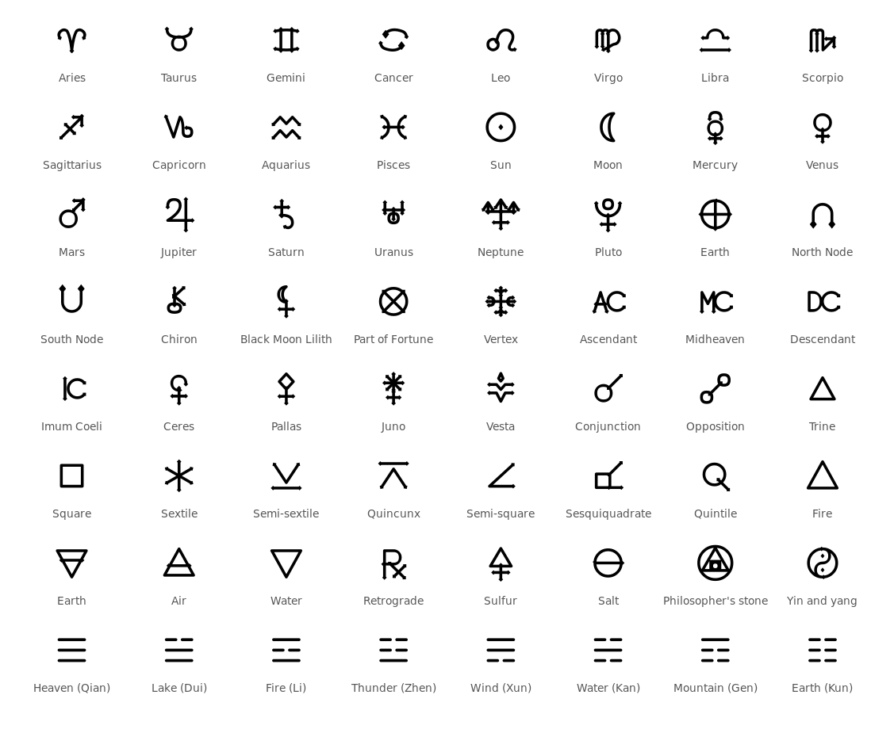

# Esoteric Icons

64 icons for astrology, alchemy and the I Ching, drawn on a 24 × 24 grid: the zodiac signs, the planets, the chart points and angles, four asteroids, ten aspects, the alchemical elements, a few hermetic symbols and the eight trigrams.

## Style

One thin stroke (1.55 on the 24 grid) with small lozenge terminals, in the spirit of old alchemical manuscripts. Dots inside glyphs (the centre of the Sun, the eyes of yin and yang) are drawn as lozenges too. Every icon is a single filled path in `currentColor`, so it takes the colour of the surrounding text.

## Icons

- **Zodiac signs** (12): `sign-aries`, `sign-taurus`, `sign-gemini`, `sign-cancer`, `sign-leo`, `sign-virgo`, `sign-libra`, `sign-scorpio`, `sign-sagittarius`, `sign-capricorn`, `sign-aquarius`, `sign-pisces`
- **Planets** (11): `planet-sun`, `planet-moon`, `planet-mercury`, `planet-venus`, `planet-mars`, `planet-jupiter`, `planet-saturn`, `planet-uranus`, `planet-neptune`, `planet-pluto`, `planet-earth`
- **Chart points** (11): `point-north-node`, `point-south-node`, `point-chiron`, `point-lilith`, `point-part-of-fortune`, `point-vertex`, `angle-ascendant`, `angle-midheaven`, `angle-descendant`, `angle-imum-coeli`, `retrograde`
- **Asteroids** (4): `asteroid-ceres`, `asteroid-pallas`, `asteroid-juno`, `asteroid-vesta`
- **Aspects** (10): `aspect-conjunction`, `aspect-opposition`, `aspect-trine`, `aspect-square`, `aspect-sextile`, `aspect-semi-sextile`, `aspect-quincunx`, `aspect-semi-square`, `aspect-sesquiquadrate`, `aspect-quintile`
- **Elements** (4): `element-fire`, `element-earth`, `element-air`, `element-water`
- **Hermetic** (4): `alchemy-sulfur`, `alchemy-salt`, `alchemy-philosophers-stone`, `yin-yang`
- **I Ching trigrams** (8): `trigram-heaven`, `trigram-lake`, `trigram-fire`, `trigram-thunder`, `trigram-wind`, `trigram-water`, `trigram-mountain`, `trigram-earth`

The files are in [`svg/`](svg/), one icon per file.

## License

[CC BY 4.0](LICENSE). You can use, change and share the icons, including in commercial work, as long as you credit **Rosmaryn** (https://rosmaryn.app).
